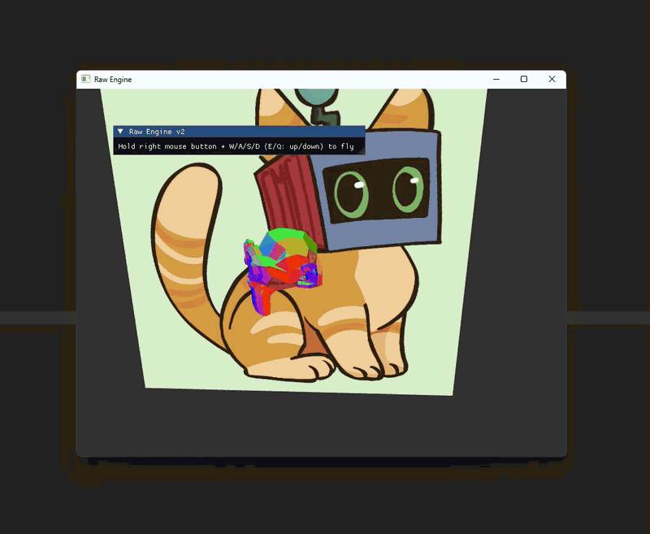
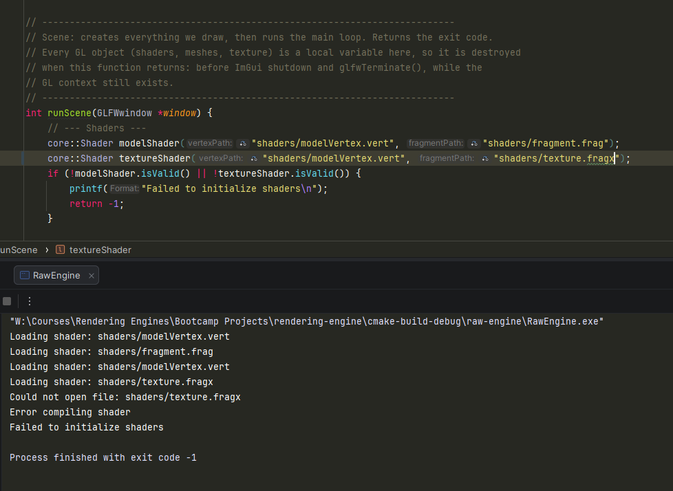

# Raw Engine

A small 3D renderer written in C++20 with OpenGL. It opens a window, draws a textured square and a 3D monkey head, and lets you fly around the scene with the mouse and keyboard.

This repository is a code sample, and also an ongoing study project. I am learning C++ and OpenGL together, and I want to keep growing in both. They fit well side by side: OpenGL gives me real, visible problems to solve (a window, a mesh, a camera), and C++ is how I solve them safely. The classes here own their graphics resources, report errors without crashing, and keep their inner workings private.

Each class has a page in the [Wiki](https://github.com/HangyBoi/rendering-engine/wiki) that explains the design choices.



## Words you may not know

You do not need to know OpenGL to read the code. These five words are enough.

| Word | Meaning |
|---|---|
| GPU | The graphics card. It has its own memory, separate from the normal program memory. |
| Mesh | The data of a 3D shape: a list of points and a list of triangles built from them. |
| Texture | An image that is wrapped around a shape. |
| Shader | A small program that runs on the GPU. It decides where each point goes and what colour each pixel gets. |
| Handle | A number that OpenGL gives you for something stored on the GPU, like a coat-check ticket. You hand the ticket back when you are done. |

The handle is the key idea. If a program forgets to hand a ticket back, GPU memory leaks. If two objects hold the same ticket and both hand it back, the program breaks. Most of the C++ in this repository is about making these mistakes impossible.

## Where to look first

These are the classes I wrote or reworked. Each one has a Wiki page.

| Class | Files | What it does | Wiki |
|---|---|---|---|
| Mesh | [mesh.h](raw-engine/core/mesh.h), [mesh.cpp](raw-engine/core/mesh.cpp) | Owns the GPU buffers of a shape. It cannot be copied, only moved, and it frees its buffers in the destructor. | [Mesh and Texture](https://github.com/HangyBoi/rendering-engine/wiki/Mesh-and-Texture) |
| Texture | [texture.h](raw-engine/core/texture.h), [texture.cpp](raw-engine/core/texture.cpp) | Loads an image onto the GPU and owns it with the same rules as Mesh. | [Mesh and Texture](https://github.com/HangyBoi/rendering-engine/wiki/Mesh-and-Texture) |
| Shader | [shader.h](raw-engine/core/shader.h), [shader.cpp](raw-engine/core/shader.cpp) | Reads, compiles and links a shader program. Reports errors with the file name. Remembers where each setting lives so it does not ask the driver twice. | [Shader](https://github.com/HangyBoi/rendering-engine/wiki/Shader) |
| Camera | [camera.h](raw-engine/core/camera.h), [camera.cpp](raw-engine/core/camera.cpp) | Holds a position and a look direction, and produces the view and projection matrices. It knows nothing about the window or the keyboard. | [Camera](https://github.com/HangyBoi/rendering-engine/wiki/Camera) |
| main | [main.cpp](raw-engine/main.cpp) | Sets up the window, builds the scene, reads the input and runs the loop, split into small functions. | |

## My work and course code

The project started from the hand-out of a course (RawEngine v2). The table shows what came with it and what I did.

| Path | Origin | What I did |
|---|---|---|
| `core/shader.h`, `core/shader.cpp` | Mine | New class. |
| `core/camera.h`, `core/camera.cpp` | Mine | New class. |
| `core/mesh.h`, `core/mesh.cpp` | Hand-out, reworked | Added the ownership rules: destructor, deleted copy, move constructor and move assignment. Safer buffer upload. |
| `core/texture.h`, `core/texture.cpp` | Hand-out, reworked | Same ownership rules. Fixed loading so a failed load creates no GPU object. |
| `core/model.h`, `core/model.cpp` | Hand-out, small changes | Takes its meshes by move instead of copying them. |
| `core/assimpLoader.h`, `core/assimpLoader.cpp` | Hand-out, small changes | Moves the finished vectors instead of copying them. |
| `core/vertex.h` | Hand-out | Unchanged. |
| `main.cpp` | Hand-out, rewritten | Uses Shader and Camera, adds mouse and keyboard input, and is split into setup, input, scene and entry point. |
| `shaders/` | Hand-out | Not part of my C++ work. |
| `imgui/` | Third party | Dear ImGui, bundled with the hand-out. |
| `models/`, `textures/` | Course assets | The monkey model and the cat image. |
| `bootcamp-01/` | Mine | My solutions to the C++ basics exercises (pointers, arrays, functions) that the students of the course work through. I help those students. |

The Git history follows the same steps, so `git log` shows how each class was built.

## C++ ideas in the code

### 1. Objects that own their resources

A Mesh creates its GPU buffers in the constructor and frees them in the destructor. Nobody has to remember to clean up.

```cpp
Mesh::~Mesh() {
    if (VAO != 0) glDeleteVertexArrays(1, &VAO);
    if (VBO != 0) glDeleteBuffers(1, &VBO);
    if (EBO != 0) glDeleteBuffers(1, &EBO);
}
```

The value 0 means "owns nothing". OpenGL never hands out 0 as a real handle, so it works as a safe empty state.

### 2. One owner only: no copies, moves allowed

If a Mesh could be copied, two objects would hold the same handles and free them twice. So copying is forbidden at compile time, and moving is written by hand.

```cpp
Mesh(const Mesh&) = delete;                 // copying is a compiler error
Mesh& operator=(const Mesh&) = delete;
Mesh(Mesh&& other) noexcept;                // moving is allowed
Mesh& operator=(Mesh&& other) noexcept;
```

A move takes the handles and leaves the old object empty, so only one owner is left.

```cpp
Mesh::Mesh(Mesh&& other) noexcept {
    VAO = other.VAO;
    VBO = other.VBO;
    EBO = other.EBO;
    other.VAO = 0;   // other owns nothing now
    other.VBO = 0;
    other.EBO = 0;
    vertices = std::move(other.vertices);
    indices  = std::move(other.indices);
}
```

`Model` holds a `std::vector<Mesh>` and needs no special functions at all. The vector handles everything (the "rule of zero").

### 3. Errors are reported, not ignored

A Shader never crashes when a file is missing or the shader code is wrong. It prints the file name and the reason, stays empty, and lets the caller check.

```cpp
core::Shader modelShader("shaders/modelVertex.vert", "shaders/fragment.frag");
core::Shader textureShader("shaders/modelVertex.vert", "shaders/texture.frag");
if (!modelShader.isValid() || !textureShader.isValid()) {
    printf("Failed to initialize shaders\n");
    return -1;
}
```

Here the file name is wrong on purpose. The Shader names the file that failed, the program stops cleanly, and the exit code is -1.



### 4. Hiding the details, and saving work

The shader needs to know where each setting (a "uniform") lives. Asking the driver is slow, so the Shader asks once per name and remembers the answer. The caller just writes `setMat4("mvpMatrix", ...)`.

```cpp
GLint Shader::getUniformLocation(const std::string& name) const {
    auto it = uniformCache.find(name);
    if (it != uniformCache.end()) {
        return it->second;
    }
    GLint location = glGetUniformLocation(program, name.c_str());
    if (location == -1) {
        printf("Could not find uniform location: %s\n", name.c_str());
    }
    uniformCache[name] = location;
    return location;
}
```

The cache is `mutable`, so the setters can stay `const`: filling a cache does not change what the Shader is.

### 5. A class does one job

The Camera only turns a position and two angles into matrices. It does not read the keyboard. `main.cpp` reads the input and calls `camera.moveForward(...)` or `camera.rotate(...)`. The camera could be reused with any window library, or tested without a window.

```cpp
void Camera::updateVectors() {
    const float yawRad = glm::radians(yaw);
    const float pitchRad = glm::radians(pitch);

    front = glm::normalize(glm::vec3(std::cos(yawRad) * std::cos(pitchRad),
                                     std::sin(pitchRad),
                                     std::sin(yawRad) * std::cos(pitchRad)));
    right = glm::normalize(glm::cross(front, worldUp));
}
```

### 6. Objects die in the right order

GPU objects can only be freed while the window and its OpenGL context still exist. In `main.cpp`, everything that owns a GPU object is a local variable of `runScene()`, so it is destroyed when that function returns. Only after that does `main()` shut down the UI and the window.

```cpp
const int exitCode = runScene(window);   // shaders, meshes, texture are destroyed here

shutdownImGui();
glfwTerminate();                         // the window and context go last
return exitCode;
```

## Controls

| Input | Action |
|---|---|
| Hold the right mouse button and move the mouse | Look around |
| W / A / S / D (while holding the right mouse button) | Move forward, left, back, right |
| E / Q (while holding the right mouse button) | Move up, down |
| Escape | Quit |

## Build and run

Tested on Windows with CLion and the MSVC compiler. Linux and macOS have not been tried.

You need CMake 3.29 or newer and a C++20 compiler.

1. Install [vcpkg](https://github.com/microsoft/vcpkg) and the five libraries:
   ```
   vcpkg install glad:x64-windows glfw3:x64-windows glm:x64-windows assimp:x64-windows stb:x64-windows
   ```
   The first build of `assimp` takes 10 to 20 minutes.
2. In CLion, open Settings, then Build, Execution, Deployment, then CMake, and add this to CMake options (use your own vcpkg path):
   ```
   -DCMAKE_TOOLCHAIN_FILE=C:/vcpkg/scripts/buildsystems/vcpkg.cmake
   ```
   Then run Tools, CMake, Reset Cache and Reload Project.
3. Open the repository folder, select the `RawEngine` target and run it. The shaders, model and texture are copied next to the executable by the build.

## Project layout

```
bootcamp-01/        C++ basics exercises for the course students
bootcamp-02/        scratch work
raw-engine/
    main.cpp        window, scene, input, main loop
    core/           Mesh, Texture, Shader, Camera, Model, loader
    shaders/        GLSL shader files
    models/         3D model (Assimp loads it)
    textures/       image for the square
    imgui/          Dear ImGui (third party)
```

## Known limits

- Everything runs on one thread. Loading a model blocks the window. Moving the loading to a worker thread is the next thing I want to learn and build.
- There are no automated tests.
- There is one scene and no lighting.

## Credits

The starting code, the model and the cat texture come from the course hand-out. Libraries used: [GLFW](https://www.glfw.org/), [GLM](https://github.com/g-truc/glm), [glad](https://github.com/Dav1dde/glad), [Assimp](https://github.com/assimp/assimp), [stb](https://github.com/nothings/stb) and [Dear ImGui](https://github.com/ocornut/imgui). See each project for its licence.
